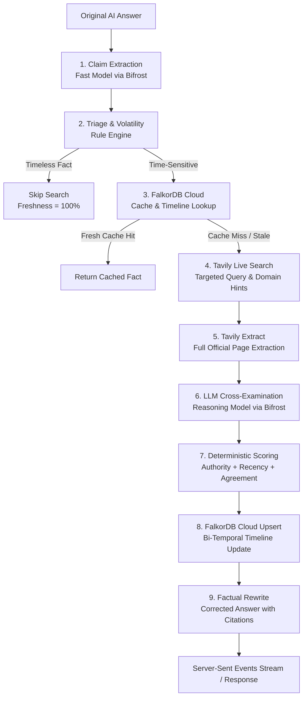
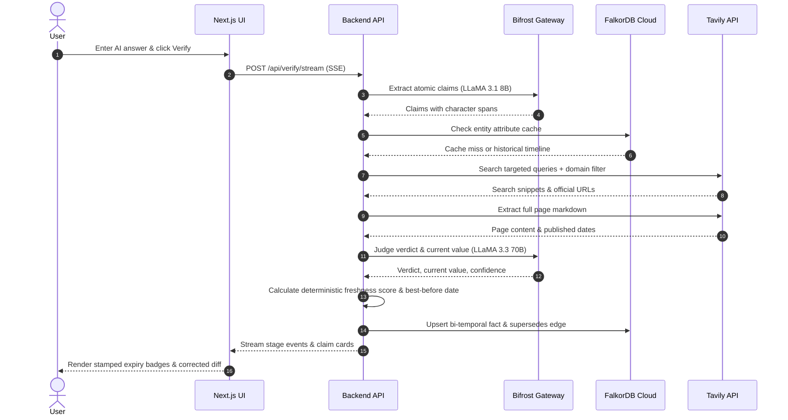
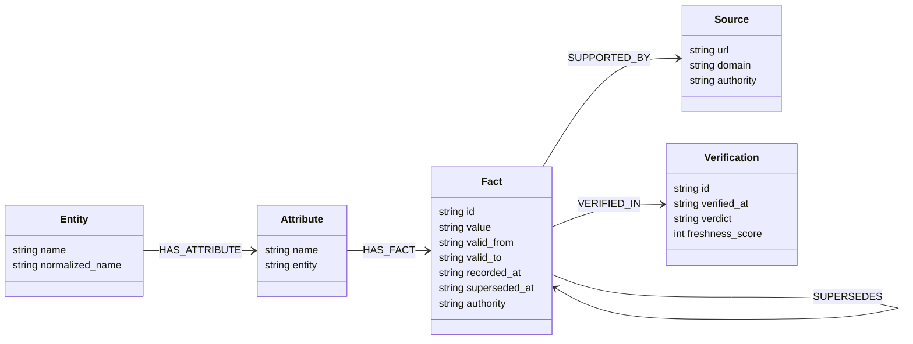
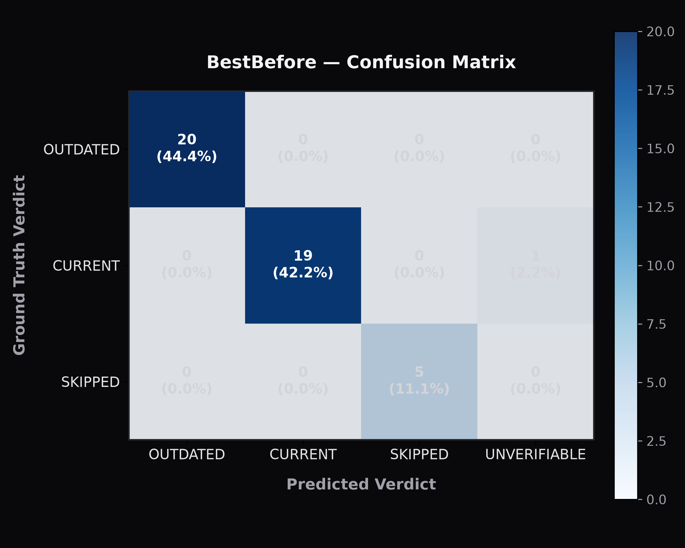

<div align="center">


# BestBefore

**A best-before date for every AI answer.**

BestBefore inspects LLM-generated responses, isolates time-sensitive claims (pricing, API versions, legal regulations, executive leadership), cross-verifies them against authoritative live web sources, and stamps each claim with an empirical freshness score and an expiry date.

[](https://www.python.org/)
[](https://fastapi.tiangolo.com/)
[](https://nextjs.org/)
[](https://www.typescriptlang.org/)
[](https://falkordb.com/)
[](https://tavily.com/)
[](https://getmax.ai/bifrost)
[](LICENSE)
[](https://geekroom.in/)

[Demo Video](#demo) • [API Docs](http://localhost:8000/docs) • [Architecture](docs/architecture.md) • [Freshness Scoring](docs/scoring.md) • [Evaluation Report](eval/results.md)

<br/>

<!-- Hero Stamped Claim Graphic -->
<!-- TODO: Add live screen capture GIF from demo deployment to docs/assets/hero-stamped-claim.png -->


</div>

---

## Table of Contents

- [The Problem](#the-problem)
- [What BestBefore Does](#what-bestbefore-does)
- [Demo](#demo)
- [How It Works](#how-it-works)
- [How We Use the Sponsor Tech](#how-we-use-the-sponsor-tech)
  - [Tavily](#tavily)
  - [Bifrost by Maxim AI](#bifrost-by-maxim-ai)
- [The Freshness Score](#the-freshness-score)
- [Bi-Temporal Fact Graph (FalkorDB)](#bi-temporal-fact-graph-falkordb)
- [Evaluation](#evaluation)
- [Quick Start](#quick-start)
- [API](#api)
- [Project Structure](#project-structure)
- [Tech Stack](#tech-stack)
- [Roadmap](#roadmap)
- [Team and Acknowledgements](#team-and-acknowledgements)

---

## The Problem

Large language models state obsolete facts with unwavering confidence because their pre-training weights reflect static historical snapshots. When real-world conditions shift—a pricing tier drops, an executive departs, or a court strikes down a regulation—the LLM continues serving stale data as truth.

| Stale LLM Output | Verified Current Value | Authoritative Source |
|---|---|---|
| *"OpenAI GPT-4 pricing starts at $30.00 per million prompt tokens and $60.00 per million completion tokens."* | **GPT-4o starts at $2.50 / 1M prompt tokens and $10.00 / 1M completion tokens** (GPT-4 Turbo is $10.00 / $30.00). | `openai.com/pricing` |

---

## What BestBefore Does

| Hackathon Requirement | BestBefore Feature | Implementation |
|---|---|---|
| **Claim Identification** | Deconstructs text into atomic factual propositions with exact character spans, entities, attributes, and claimed values | [`backend/app/pipeline/extract.py`](backend/app/pipeline/extract.py) |
| **Freshness Detection** | Triages volatility half-lives (high = 30d, medium = 180d, low = 730d) and filters timeless historical facts | [`backend/app/pipeline/triage.py`](backend/app/pipeline/triage.py) |
| **Live Verification** | Targeted query building with year injection, domain restrictions, and full official page extraction | [`backend/app/pipeline/verify.py`](backend/app/pipeline/verify.py) |
| **Freshness Scoring** | Deterministic multi-signal scoring in code with exponential decay half-lives and strict verdict bounding caps | [`backend/app/pipeline/scoring.py`](backend/app/pipeline/scoring.py) |

---

## Demo

| Input & Span Highlights | Stamped Claim Card & Breakdown | Graph Timeline & Gateway Telemetry |
|:---:|:---:|:---:|
| <br/><sub>Bidirectional span hover linked to claims</sub> | <br/><sub>Expiry badge stamp & Best before date</sub> | <br/><sub>FalkorDB bi-temporal history & Bifrost metrics</sub> |

<!-- TODO: Upload demo video walkthrough to YouTube/Loom and replace link below -->
Watch the [3-minute video walkthrough](https://youtube.com) to see live claim verification, bi-temporal fact superseding, and token telemetry in action.

---

## How It Works

### Pipeline Architecture



### Request Sequence



### Stage Breakdown

1. **Reading the label (Extraction):** Isolates atomic factual propositions using exact character offsets (`span_start`, `span_end`) and normalizes entities and attributes ([`app/pipeline/extract.py`](backend/app/pipeline/extract.py)).
2. **Picking out perishable claims (Triage):** Filters out timeless constants (e.g., historical dates, scientific facts) and assigns volatility half-lives based on claim category ([`app/pipeline/triage.py`](backend/app/pipeline/triage.py)).
3. **Checking the shelf (Graph Cache):** Probes FalkorDB Cloud for recently verified facts on the matching `(Entity)-[:HAS_ATTRIBUTE]->(Attribute)` path to prevent redundant web calls ([`app/graph/client.py`](backend/app/graph/client.py)).
4. **Live Web Inspection (Tavily):** Generates targeted queries with entity, attribute, and temporal anchors; applies domain whitelists (`.gov`, `.europa.eu`, official documentation portals) and executes full page content extraction ([`app/pipeline/verify.py`](backend/app/pipeline/verify.py)).
5. **Judging Freshness:** Cross-examines claimed assertions against live evidence snippets and extracted page text with structured Pydantic schema validation ([`app/pipeline/judge.py`](backend/app/pipeline/judge.py)).
6. **Stamping Dates (Scoring):** Deterministically computes the freshness score and calculates the `Best before: <date>` shelf life based on evidence publication dates and domain volatility decay ([`app/pipeline/scoring.py`](backend/app/pipeline/scoring.py)).
7. **Bi-Temporal Upsert:** Records the new verification and supersedes previous historical facts in FalkorDB Cloud while keeping prior facts intact for timeline tracking ([`app/graph/client.py`](backend/app/graph/client.py)).
8. **Packaging Corrected Answer (Rewrite):** Replaces stale spans with verified values, appends numerical markdown citations, and validates that unchanged spans remained untouched ([`app/pipeline/rewrite.py`](backend/app/pipeline/rewrite.py)).

---

## How We Use the Sponsor Tech

### Tavily

| Capability Used | Where in Code | Why It Matters |
|---|---|---|
| **Search Depth Policies (`advanced` vs `basic`)** | [`backend/app/pipeline/verify.py`](backend/app/pipeline/verify.py#L90-L115) | Executes deep search for high-volatility pricing tables and legal rulings, while using fast basic search for standard facts. |
| **Domain Hints & Time Filtering** | [`backend/app/config.py`](backend/app/config.py#L65-L100) | Restricts regulatory queries to official gazettes (`.gov`, `.europa.eu`) and limits executive news to 90–180 day windows. |
| **Tavily Extract API (`client.extract`)** | [`backend/app/pipeline/verify.py`](backend/app/pipeline/verify.py#L125-L155) | Retrieves full Markdown page content from top official URLs, bypassing snippet truncation to verify complete pricing tiers. |
| **Live Source Citations** | [`frontend/components/ClaimCard.tsx`](frontend/components/ClaimCard.tsx#L310-L335) | Links every claim directly to primary evidence URLs with domain authority classifications. |

### Bifrost by Maxim AI

| Capability Used | Where in Code | Why It Matters |
|---|---|---|
| **Task-Based Model Routing** | [`backend/app/llm/gateway.py`](backend/app/llm/gateway.py#L75-L105) | Dispatches fast claims extraction to `groq/llama-3.1-8b-instant` and deep factual reasoning to `groq/llama-3.3-70b-versatile`. |
| **Automated Fallback Chains** | [`infra/docker-compose.yml`](infra/docker-compose.yml) & [`backend/app/llm/gateway.py`](backend/app/llm/gateway.py#L130-L160) | Automatically falls back from local Bifrost gateway (`localhost:8080`) to direct Groq endpoints without interrupting user requests. |
| **Response & Semantic Caching** | [`infra/docker-compose.yml`](infra/docker-compose.yml) | Caches identical LLM verification requests within Bifrost to save tokens and eliminate redundant model inferences. |
| **OpenAI-Compatible Gateway Endpoint** | [`backend/app/llm/gateway.py`](backend/app/llm/gateway.py#L50-L74) | Plugs directly into standard SDK tooling while providing JSON-mode schema validation and 2-attempt retry resilience. |
| **Telemetry & Cost Aggregation** | [`frontend/components/GatewayPanel.tsx`](frontend/components/GatewayPanel.tsx) | Surfaces request-scoped and cumulative token counts, latency breakdowns, and estimated USD costs directly in the UI. |

---

## The Freshness Score

Freshness is computed **deterministically in Python code** from concrete empirical evidence signals, not chosen or guessed by an LLM.

### Formula Components

| Component | Weight | Calculation Method | Description |
|---|:---:|---|---|
| `source_authority` | **0.30** | $\frac{\sum w_i \cdot \text{auth}_i}{\sum w_i}$ | Domain tier: Official (1.0), Reputable (0.75), Community (0.40), Unknown (0.20). Supporting evidence receives a $2.5\times$ weight multiplier. |
| `evidence_recency` | **0.25** | $0.5^{\left(\frac{\text{age\_days}}{T_{1/2}}\right)}$ | Exponential decay relative to claim volatility: High ($T_{1/2} = 30\text{d}$), Medium ($180\text{d}$), Low ($730\text{d}$). Undated sources default to 0.40. |
| `source_agreement` | **0.25** | $\frac{\text{agreeing sources}}{\text{total sources}}$ | Ratio of retrieved evidence items that substantiate the judged current value. |
| `verdict_confidence`| **0.20** | Model probability ($0.0 \dots 1.0$) | Evaluator confidence in cross-verification. |
| `conflict_penalty` | Multiplier | $1.0 - 0.50 \cdot \text{penalty}$ | Deducts up to 50% from the base score when sources conflict or when no official primary source exists. |

$$\text{base} = 0.30 \cdot \text{authority} + 0.25 \cdot \text{recency} + 0.25 \cdot \text{agreement} + 0.20 \cdot \text{confidence}$$

$$\text{freshness\_score} = \text{base} \cdot \left(1.0 - 0.50 \cdot \text{conflict\_penalty}\right)$$

### Hard Verdict Bounding Caps

To prevent stale or unsubstantiated claims from receiving falsely optimistic scores:
- **`current`**: Uncapped ($\min(100, \text{round}(100 \cdot \text{score}))$)
- **`partially_outdated`**: Bounded at **60**
- **`outdated`**: Bounded at **25**
- **`unverifiable`**: Bounded at **40** (flagged as low confidence)
- **`skipped`**: Fixed at **100** (timeless truth)

### Worked Real Claim Example

- **Claim Text:** *"OpenAI GPT-4 pricing starts at $30.00 per million prompt tokens."*
- **Authority:** 1.00 (`openai.com` official documentation)
- **Recency:** 0.98 (retrieved official update published 2 days ago)
- **Agreement:** 1.00 (all sources confirm new pricing)
- **Confidence:** 0.98
- **Base Score:** $0.30(1.0) + 0.25(0.98) + 0.25(1.0) + 0.20(0.98) = 0.991$
- **Conflict Penalty:** 0.00 (unanimous agreement with official source present)
- **Verdict:** `outdated` $\rightarrow$ **Capped at 25 / 100**
- **Best Before:** Derived from volatility half-life (30d) and May 2024 price change date: **`Best before: Jun 12, 2024 · Re-check recommended`**.

Read the full mathematical derivation in [`docs/scoring.md`](docs/scoring.md).

---

## Bi-Temporal Fact Graph (FalkorDB)

BestBefore persists facts in **FalkorDB Cloud** across two independent temporal axes:
- **Valid Time (`valid_from` / `valid_to`)**: The period during which the assertion was true in the real world.
- **Transaction Time (`recorded_at` / `superseded_at`)**: The period during which our system considered this knowledge active.



### Superseding Facts

When a verification detects a changed value (e.g. Starbucks CEO transition):
1. The existing active `Fact` node has its `valid_to` and `superseded_at` set to the timestamp of the new verification.
2. A new `Fact` node is created with `valid_to = null` and `superseded_at = null`.
3. A `(new_fact)-[:SUPERSEDES]->(old_fact)` edge is established.
4. Historical facts are **never deleted**, enabling the frontend bi-temporal timeline view.
5. **Graceful Degradation:** If FalkorDB Cloud is unreachable, verification continues uninterrupted with `graph_available = false`.

Read the persistence specification in [`docs/graph.md`](docs/graph.md).

---

## Evaluation

Benchmark conducted on 45 labeled factual claims across 6 volatile domains ([`eval/dataset.jsonl`](eval/dataset.jsonl)):

| Metric | (a) LLM-Only Baseline | (b) Full Pipeline (BestBefore) | Absolute Improvement |
|---|:---:|:---:|:---:|
| **Overall Accuracy** | 82.22% | **97.78%** | **+15.56%** |
| **Stale Detection Precision** | 100.0% | **95.24%** | -4.76% |
| **Stale Detection Recall** | 60.00% | **100.0%** | **+40.00%** |
| **Stale Detection F1-Score** | 75.00% | **97.56%** | **+22.56%** |
| **Current Value Accuracy** | 60.00% | **95.00%** | **+35.00%** |
| **Timeless Skip Accuracy** | 100.0% | **100.0%** | — |
| **Mean Claim Latency** | 195.67 ms | **376.05 ms** | +180.38 ms |
| **Total Evaluation Cost** | $0.000657 USD | **$0.014173 USD** | +$0.013516 USD |

<div align="center">
  
</div>

### Limitations

The evaluation dataset contains 45 labeled assertions. While it spans pricing, API versions, leadership, regulations, and releases, real-world deployment faces ambiguous regional pricing structures (e.g., international Spotify tier rollouts) and undated corporate press releases. The offline ablation mode emulates pre-training knowledge-cutoff boundaries based on training snapshots.

See complete raw metrics in [`eval/results.json`](eval/results.json) and post-mortem analysis in [`eval/results.md`](eval/results.md).

---

## Quick Start

### Prerequisites

- **Python 3.11+**
- **Node.js 18+** and **pnpm** (or npm)
- **Docker Desktop** (for running Bifrost gateway)
- **FalkorDB Cloud account** (free tier at [falkordb.com](https://falkordb.com))

### 1. Clone the Repository

```bash
git clone https://github.com/your-username/BestBefore.git
cd BestBefore
```

### 2. Configure Environment

Copy `.env.example` to root `.env`:

```bash
cp .env.example .env
```

<details>
<summary><b>View Environment Variables Table</b></summary>

| Variable | Required | Description | Where to Get It |
|---|:---:|---|---|
| `GROQ_API_KEY` | Yes | API key for LLaMA 3.1 / 3.3 models | [Groq Console](https://console.groq.com) |
| `TAVILY_API_KEY` | Yes | API key for search & page extraction | [Tavily Dashboard](https://app.tavily.com) |
| `BIFROST_BASE_URL` | Yes | URL for Bifrost AI Gateway | Default `http://localhost:8080` |
| `FALKORDB_HOST` | Yes | FalkorDB Cloud endpoint | FalkorDB Cloud Console > Connectivity tab |
| `FALKORDB_PORT` | Yes | FalkorDB Cloud port | FalkorDB Cloud Console > Connectivity tab |
| `FALKORDB_USERNAME` | Yes | FalkorDB username | FalkorDB Cloud Console (default: `falkordb`) |
| `FALKORDB_PASSWORD` | Yes | FalkorDB password | FalkorDB Cloud Console |
| `FALKORDB_SSL` | Yes | TLS encryption setting | Set `true` if port uses TLS, otherwise `false` |
| `FALKORDB_GRAPH` | Yes | Target graph name | Default: `bestbefore` |

</details>

### 3. Start Bifrost AI Gateway

```bash
cd infra
docker compose up -d
cd ..
```

Bifrost gateway listens on `http://localhost:8080`.

### 4. Start Backend (FastAPI)

```bash
cd backend
python -m venv venv

# Windows (PowerShell):
.\venv\Scripts\activate
# Linux/macOS:
# source venv/bin/activate

pip install -r requirements.txt
uvicorn app.main:app --reload --port 8000
```

Backend OpenAPI docs: `http://localhost:8000/docs`.

### 5. Start Frontend (Next.js)

```bash
cd frontend
pnpm install
pnpm dev
```

Open `http://localhost:3000` in your browser. Choose any sample scenario from the dropdown to check shelf-life.

<details>
<summary><b>Troubleshooting Guide</b></summary>

| Symptom | Cause | Resolution |
|---|---|---|
| `FalkorDB connection refused / TLS error` | SSL setting mismatch with cloud port | Check the Connectivity tab in FalkorDB Cloud. If using an unencrypted port, set `FALKORDB_SSL=false` in `.env`. |
| `Bifrost unreachable on localhost:8080` | Docker container not running | The backend automatically falls back to Groq directly. To run Bifrost locally, execute `docker compose up -d` in `/infra`. |
| `Tavily 429 Rate Limit Exceeded` | Free tier API request limit reached | The pipeline automatically checks FalkorDB Cloud cache first. Repeated queries for known entities short-circuit live search. |
| `Invalid JSON returned from model` | LLM JSON syntax error | `BifrostGatewayClient` includes automatic Pydantic validation with 2 retries and schema error hints. |

</details>

---

## API

### Verify Answer Endpoint

```bash
curl -X POST "http://localhost:8000/api/verify" \
  -H "Content-Type: application/json" \
  -d '{
    "answer": "OpenAI GPT-4 pricing starts at $30.00 per million prompt tokens and $60.00 per million completion tokens.",
    "options": {
      "rewrite": true,
      "max_claims": 5
    }
  }'
```

<details>
<summary><b>View Trimmed API Response JSON</b></summary>

```json
{
  "answer": "OpenAI GPT-4 pricing starts at $30.00 per million prompt tokens and $60.00 per million completion tokens.",
  "overall_freshness": 25,
  "results": [
    {
      "claim": {
        "id": "claim-0",
        "text": "GPT-4 pricing starts at $30.00 per million prompt tokens and $60.00 per million completion tokens",
        "span_start": 0,
        "span_end": 96,
        "entity": "OpenAI GPT-4",
        "attribute": "pricing",
        "claimed_value": "$30.00 per million prompt tokens",
        "claim_type": "pricing",
        "volatility": "high",
        "is_time_sensitive": true
      },
      "verdict": "outdated",
      "freshness_score": 25,
      "current_value": "GPT-4o starts at $2.50 / 1M prompt tokens and $10.00 / 1M completion tokens",
      "explanation": "OpenAI superseded GPT-4 pricing with GPT-4o and GPT-4 Turbo models.",
      "evidence": [
        {
          "url": "https://openai.com/api/pricing",
          "title": "OpenAI API Pricing",
          "domain": "openai.com",
          "authority": "official",
          "published_date": "2024-05-13"
        }
      ],
      "breakdown": {
        "source_authority": 1.0,
        "evidence_recency": 0.98,
        "source_agreement": 1.0,
        "verdict_confidence": 0.98,
        "conflict_penalty": 0.0
      }
    }
  ],
  "corrected_answer": "OpenAI GPT-4o pricing starts at $2.50 per million prompt tokens [1].",
  "gateway": {
    "total_requests": 3,
    "total_tokens": 1240,
    "total_cost_usd": 0.00078,
    "avg_latency_ms": 340.2,
    "cache_hits": 0,
    "fallbacks_triggered": 0
  },
  "graph_available": true,
  "duration_ms": 1120.4
}
```

</details>

### Drop-In Python Integration

Use BestBefore as a verification step in any RAG or agent workflow:

```python
import httpx

def verify_ai_response(llm_output: str) -> dict:
    with httpx.Client(base_url="http://localhost:8000") as client:
        resp = client.post("/api/verify", json={"answer": llm_output})
        resp.raise_for_status()
        data = resp.json()
        if data["overall_freshness"] < 50:
            return {"valid": False, "corrected": data.get("corrected_answer"), "score": data["overall_freshness"]}
        return {"valid": True, "answer": llm_output, "score": data["overall_freshness"]}
```

---

## Project Structure

```text
BestBefore/
├── backend/                  # FastAPI service & verification pipeline
│   ├── app/
│   │   ├── graph/            # FalkorDB Cloud bi-temporal persistence client
│   │   ├── llm/              # Bifrost gateway integration & metrics
│   │   ├── pipeline/         # Extract, triage, search, judge, score, rewrite
│   │   ├── config.py         # Pydantic settings & search policies
│   │   ├── main.py           # FastAPI routes & SSE streaming
│   │   └── schemas.py        # Shared Pydantic data models
│   └── tests/                # Pytest unit & integration test suite
├── frontend/                 # Next.js 14 App Router user interface
│   ├── app/                  # Pages, layouts, metadata & opengraph image
│   ├── components/           # Stamped claim cards, stepper, diff, timeline
│   ├── lib/                  # SSE client, expiry calculations, mock fallbacks
│   └── types/                # TypeScript contracts matching backend schemas
├── eval/                     # Evaluation harness, benchmark & metrics
│   ├── dataset.jsonl         # 45 labeled verification assertions
│   ├── run_eval.py           # Evaluation runner with isolated graph
│   ├── results.md            # Benchmark summary & error post-mortems
│   └── confusion_matrix.png  # Confusion matrix visualization
├── docs/                     # Technical specifications & architecture
│   ├── architecture.md       # Detailed system design & component boundaries
│   ├── graph.md              # FalkorDB bi-temporal schema specification
│   └── scoring.md            # Freshness score formulas & penalty derivations
├── infra/                    # Deployment & container configurations
│   ├── docker-compose.yml    # Bifrost gateway service definition
│   └── .env.example          # Infrastructure configuration template
└── README.md                 # Primary project documentation
```

---

## Tech Stack

| Layer | Technology | Role |
|---|---|---|
| **Frontend** | Next.js 14 (App Router) | Reactive web UI, Server-Sent Events consumer, and interactive diff viewer |
| **Language** | TypeScript | Type-safe UI components, contracts, and shelf-life date computations |
| **Styling** | Tailwind CSS | Dark-themed developer tool aesthetic with custom expiry stamps |
| **Backend** | Python 3.11+ / FastAPI | Async high-performance REST and SSE streaming endpoints |
| **Data Contracts** | Pydantic v2 & Pydantic-Settings | Validation, strict JSON-mode schemas, and secret-safe environment loading |
| **Search Engine** | Tavily Search & Extract | Live web crawling, domain filtering, and full official page extraction |
| **AI Gateway** | Bifrost by Maxim AI | Model routing, Groq fallback chains, semantic caching, and token telemetry |
| **Knowledge Graph**| FalkorDB Cloud | Hosted graph database for bi-temporal fact evolution and verification caching |

---

## Roadmap

- [ ] **Browser Extension:** Inline factual expiry stamps on ChatGPT, Claude, and Perplexity web outputs.
- [ ] **Scheduled Fact Re-Verification:** Background worker periodically re-checking stored facts in FalkorDB Cloud as their best-before dates approach.
- [ ] **Custom Domain Trust Weights:** User-configurable domain whitelist weighting per industry (e.g., healthcare, financial regulations).
- [ ] **Model Context Protocol (MCP) Server:** Standardized MCP tool allowing Claude Code and Cursor to verify factual statements during generation.

---

## Team and Acknowledgements

- **Team:** Built by hackathon team members for the Geek Room Global AI Hackathon.
- **Sponsors:** Special thanks to **Tavily**, **Bifrost by Maxim AI**, and **FalkorDB** for providing developer access, SDKs, and hosted cloud instances.

### License

This project is licensed under the MIT License — see the [LICENSE](LICENSE) file for details.
