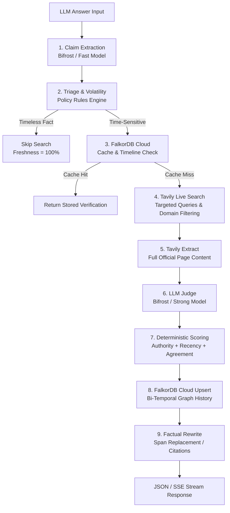

# BestBefore — Architecture Overview

## System Flow

BestBefore takes an LLM-generated text answer, extracts factual assertions, verifies them against live authoritative web data, and stamps each claim with an empirical freshness score and best-before date.

---

## Component Boundaries

### 1. Frontend (`/frontend`)
- **Next.js 14 App Router** + **TypeScript** + **Tailwind CSS**.
- Real-time **Server-Sent Events (SSE)** consumer updating pipeline stepper and claim cards progressively.
- Interactive highlighted answer pane with bidirectional hover highlighting to claim cards.
- Expiry badge stamps (`FRESH`, `PARTLY STALE`, `STALE`, `TIMELESS`, `UNVERIFIED`).
- Gateway telemetry monitor, diff viewer, and export options (JSON / Markdown).

### 2. Backend (`/backend`)
- **FastAPI** + **Pydantic v2** + **pydantic-settings**.
- Pipeline stages:
  - `app/pipeline/extract.py`: Claims parser with character offset recovery.
  - `app/pipeline/triage.py`: Time-sensitivity & volatility classifier.
  - `app/pipeline/verify.py`: Tavily search engine with depth policies & full page extract.
  - `app/pipeline/judge.py`: Evidence cross-verifier with Pydantic JSON validation.
  - `app/pipeline/scoring.py`: Deterministic math formula with recency decay half-lives.
  - `app/pipeline/rewrite.py`: Citation-preserving corrected answer generator.

### 3. Persistence Layer (`/backend/app/graph/`)
- Remote hosted **FalkorDB Cloud** graph database (`bestbefore`).
- Bi-temporal fact tracking (`valid_from`/`valid_to` vs `recorded_at`/`superseded_at`).
- Automatic graceful degradation: If remote cloud database drops, requests succeed with `graph_available=false`.

### 4. AI Gateway (`/infra/` & `/backend/app/llm/gateway.py`)
- **Bifrost by Maxim AI** Docker gateway container running on `localhost:8080`.
- Task-specific model routing (`extract` -> LLaMA 3.1 8B, `judge` -> LLaMA 3.3 70B).
- Automatic fallback chain to direct Groq API endpoint if gateway container is stopped.
- Request-scoped metrics aggregation for tokens, cost, latency, and cache hits.

